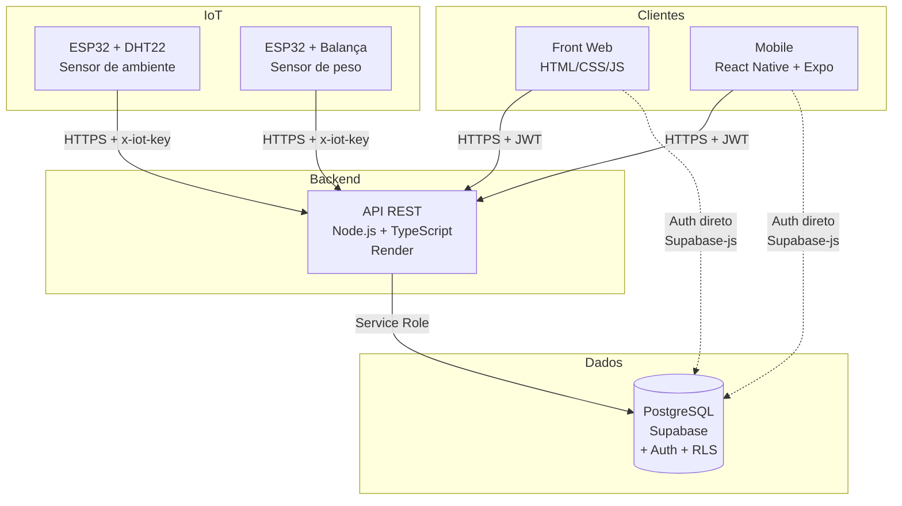
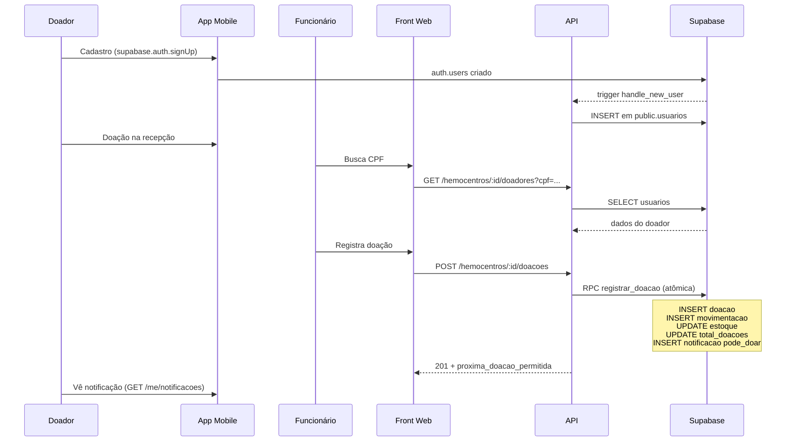
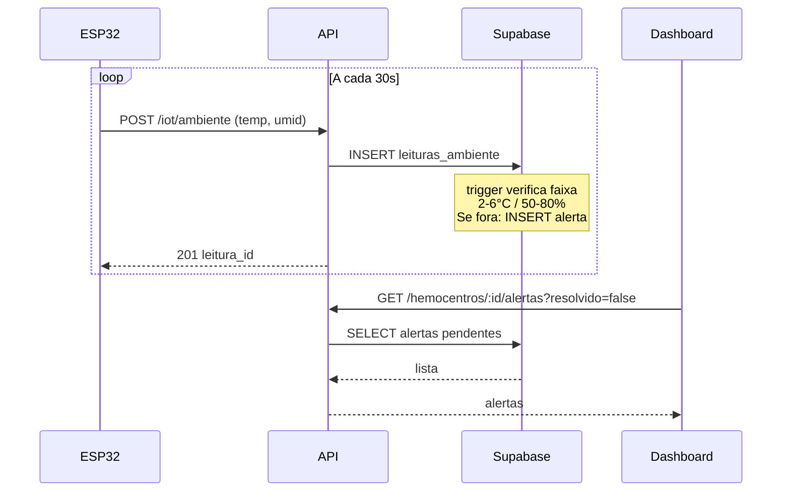
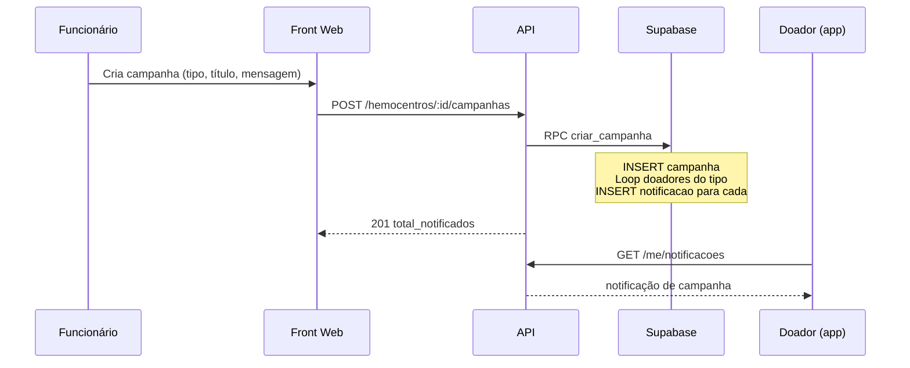

# Arquitetura — Nosso Sangue

## Visão geral

## Componentes

### Backend (API REST)

- **Stack:** Node.js 22, TypeScript, Express, Zod, Supabase-js
- **Deploy:** Render (free tier)
- **URL:** https://nosso-sangue-api.onrender.com/api/v1
- **Docs interativas:** https://nosso-sangue-api.onrender.com/docs
- **Autenticação:** valida JWT do Supabase em toda rota protegida
- **Ingestão IoT:** header `x-iot-key` para dispositivos

### Banco de dados (Supabase)

- **PostgreSQL 15** com extensões `pgcrypto` e `pg_cron`
- **Auth (GoTrue):** gerencia login, cadastro, JWT, reset de senha
- **Row Level Security (RLS):** policies por perfil (doador, funcionário, público)
- **19 migrations** versionadas em `supabase/migrations/`
- **RPCs (funções SQL):**
  - `processar_leitura_balanca` — detecta movimentação por delta de peso
  - `registrar_doacao` — operação atômica de registro de doação
  - `previsao_demanda_sazonal` — SARIMA simplificado com índice sazonal
  - `relatorio_media_doacoes`, `relatorio_estudo_doador`, `relatorio_cep`

### Front Web

- **Stack:** HTML + CSS + JavaScript puro (módulos ES), sem build
- **Auth:** `supabase-js` via CDN
- **Deploy:** Vercel (planejado)
- **Páginas:** login, dashboard, estoque, câmara fria, alertas, doador, campanha, relatórios

### Mobile

- **Stack:** React Native + Expo + Expo Router
- **Auth:** `supabase-js` com AsyncStorage
- **Deploy:** Expo Go (dev) ou EAS Build (produção)
- **Telas:** login, home (hemocentros por cidade), perfil, histórico, notificações

### IoT

- **Hardware:** ESP32 + sensor DHT22 (temperatura e umidade) + balança de precisão
- **Protocolo:** HTTP POST a cada 30 segundos
- **Autenticação:** header `x-iot-key` (gerado no Render)
- **Endpoints:** `POST /iot/ambiente` e `POST /iot/balanca`

## Fluxos principais

### 1. Doação de sangue

### 2. Ingestão IoT

### 3. Campanha

## Segurança

- **JWT do Supabase** em toda rota autenticada
- **RLS** protege os dados mesmo se a `Publishable key` for obtida (é pública)
- **Service role** só usada no backend (nunca no front/mobile)
- **Validação com Zod** em toda entrada
- **Helmet** + CORS configurável por ambiente
- **`x-powered-by` desabilitado** (reduz fingerprinting)
- **`errorHandler`** não vaza mensagem interna de erro 5xx em produção

## Decisões de arquitetura

Registradas em `docs/adr/`:
- ADR-001: Autenticação via Supabase no cliente
- ADR-002: Acesso ao banco (service role vs JWT)
- ADR-003: Protocolo IoT (HTTP POST em vez de MQTT)
- ADR-004: Deploy (Render + Supabase remoto)
- ADR-005: Notificações (mock estruturado)
- ADR-006: Contrato de API (versionamento e formato de erro)
- ADR-007: Banco local e migrations